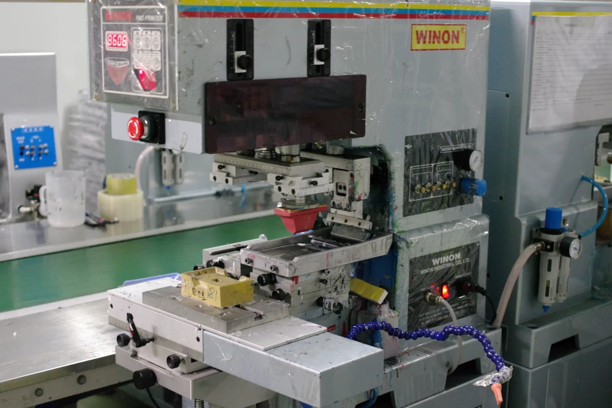

# Fotografias de técnicas para brindes.pt

Cinco fotografias reais para ilustrar as cinco páginas de técnicas existentes. Fotografias de terceiros, apenas como exemplos dos processos/equipamentos; não apresentam instalações, equipamentos nem trabalhos da Nobrinde.

## Como inserir

1. Copiar `assets/tecnicas/` para a pasta `assets/tecnicas/` do projeto.
2. Em cada página `tecnicas/<nome>.html`, colocar a fotografia correspondente (exemplo abaixo). O caminho relativo desde a página é `../assets/tecnicas/<nome>.webp`.
3. Copiar a tabela de créditos para uma página pública do site, por exemplo `creditos-imagens.html`, e manter os links e a indicação de redimensionamento. Acrescentar nessa página os créditos de outras imagens utilizadas no futuro.
4. Usar legendas como «Exemplo ilustrativo de uma máquina de tampografia». Não apresentar as fotografias como produção da Nobrinde.

```html
<figure>
  
  <figcaption>Exemplo ilustrativo de equipamento de tampografia.</figcaption>
</figure>
```

Ajustar `width` e `height` ao tamanho efetivo de cada fotografia se incluídos no HTML. As versões entregues são WebP, redimensionadas para um máximo de 1600 px no lado maior, sem recorte.

## Créditos e condições de utilização

| Ficheiro | Fotografia | Autor | Licença | Fonte |
| --- | --- | --- | --- | --- |
| `tampografia.webp` | Máquina de tampografia | Swoolverton | [CC BY 3.0](https://creativecommons.org/licenses/by/3.0/) | [Wikimedia Commons](https://commons.wikimedia.org/wiki/File:Pad_printing_machine.JPG) |
| `serigrafia.webp` | Demonstração de serigrafia | Ahmad Ali Karim | [CC0 1.0](https://creativecommons.org/publicdomain/zero/1.0/) | [Wikimedia Commons](https://commons.wikimedia.org/wiki/File:Screen_printing_demonstration_at_TEDxUTM.jpg) |
| `gravacao-a-laser.webp` | Máquina de gravação a laser | Rht bd | [CC BY-SA 4.0](https://creativecommons.org/licenses/by-sa/4.0/) | [Wikimedia Commons](https://commons.wikimedia.org/wiki/File:Laser_engraving_machine.jpg) |
| `impressao-uv.webp` | Impressora UV Mimaki | Akaniji | [CC BY-SA 3.0](https://creativecommons.org/licenses/by-sa/3.0/) | [Wikimedia Commons](https://commons.wikimedia.org/wiki/File:UV_printer_MIMAKI_3042HG.JPG) |
| `bordado.webp` | Máquina de bordado | Srini297 | [CC BY-SA 4.0](https://creativecommons.org/licenses/by-sa/4.0/) | [Wikimedia Commons](https://commons.wikimedia.org/wiki/File:Embroidery_machine.jpg) |

**Alterações a declarar publicamente:** todas as fotografias foram redimensionadas e convertidas de JPEG para WebP sem recorte para utilização no site. Créditos e licenças das imagens referem-se apenas às fotografias, sem implicar endosso da Nobrinde pelos autores. Ao adaptar imagens CC BY-SA, manter a mesma licença ou uma compatível na adaptação. Ver condições completas nos links acima. Para `serigrafia.webp`, a atribuição é facultativa segundo CC0, mas mantida para transparência.
